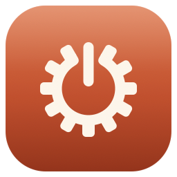
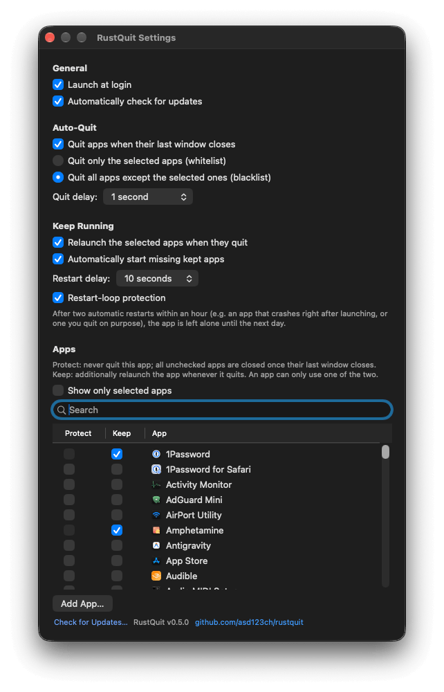

<p align="center">
  
</p>

<h1 align="center">RustQuit</h1>

<p align="center">
  Quit macOS apps when their last window closes.<br>
  A native menu bar utility, built in Rust. Free and open source.
</p>

<p align="center">
  
  <a href="LICENSE"></a>
  
  <a href="#privacy-and-security"></a>
  <a href="https://github.com/asd123ch/rustquit/actions/workflows/ci.yml"></a>
  <a href="https://scorecard.dev/viewer/?uri=github.com/asd123ch/rustquit"></a>
</p>

<p align="center">
  <a href="#features">Features</a> ·
  <a href="#beyond-swiftquit">Beyond SwiftQuit</a> ·
  <a href="#install">Install</a> ·
  <a href="#usage">Usage</a> ·
  <a href="#privacy-and-security">Privacy &amp; security</a> ·
  <a href="#contributing">Contributing</a>
</p>

On macOS, the red close button usually closes a window but leaves the app
running. RustQuit asks the app to quit after its last window closes, just
like pressing ⌘Q. Save dialogs remain available; apps are never force-quit.

<p align="center">
  
</p>

## Features

- Choose **Quit** to close only selected apps, or **Protect** to leave selected
  apps alone while quitting the rest.
- Use **Keep** to relaunch essential apps after they exit. Optionally start
  missing kept apps automatically, without bringing their windows to the front.
- Keep menu bar helpers running without repeatedly reopening their settings.
- Pause Keep for 24 hours, resume it early, or let restart-loop protection stop
  an app that repeatedly exits.
- Reopen recently closed apps directly from the menu bar.
- Set the quit delay from 0.05 to 10 seconds and the restart delay from 1 to
  60 seconds. A new window cancels a pending quit.
- Find apps in a searchable native list, show only selected apps, or add an
  app manually. No Electron or web view.
- Launch at login and see permission warnings only when action is needed.
- Check for updates automatically or from Settings. The menu shows an update
  action only when a newer release is available.

## Beyond SwiftQuit

Inspired by [SwiftQuit](https://github.com/onebadidea/swiftquit), RustQuit is an
independent Rust implementation. **It can keep apps running as well as quit
them**, with temporary pauses and a Recently Quit menu for reopening apps.

RustQuit also uses conservative checks to reduce unintended quits, including
failure modes reported with SwiftQuit such as
[quitting after a tab closes](https://github.com/onebadidea/swiftquit/issues/6):

- Window events trigger fresh counts, not an immediate quit. RustQuit checks
  again after the delay, so a newly opened window can cancel the request.
- Minimized windows and windows on other desktops count as open. Switching
  Spaces cancels pending quit decisions.
- If Accessibility or window-server state cannot be checked reliably, the
  app stays running. Finder, RustQuit and core system tools are always protected.

These safeguards favour leaving an app open over risking an unintended quit.
Apps with incomplete Accessibility support can still require manual quitting.

## Install

Requires **macOS 13 or newer** and **Apple Silicon (M1 or newer)**.
Tested on **macOS 27**.

### Homebrew

Install with [Homebrew](https://brew.sh):

```sh
brew install --cask asd123ch/tap/rustquit
```

Update an existing Homebrew installation:

```sh
brew upgrade --cask rustquit
```

### Download

Download the DMG from [GitHub Releases](https://github.com/asd123ch/rustquit/releases/latest)
and drag RustQuit into Applications. Public release builds are Developer ID
signed and Apple-notarized. Local test builds are not notarized.

### Updates

Automatic checks are enabled by default. RustQuit checks GitHub at launch and
once a day. The menu shows **Update to RustQuit …** only when an update is
available; selecting it opens the release page.

Disable automatic checks in Settings at any time. **Check for Updates** stays
available in Settings. RustQuit never downloads or installs updates itself.

<details>
<summary>Build from source</summary>

You need an Apple Silicon Mac, Xcode Command Line Tools
(`xcode-select --install`) and Rust 1.88 or newer via [rustup](https://rustup.rs).

```sh
git clone https://github.com/asd123ch/rustquit.git
cd rustquit
scripts/make-signing-identity.sh   # one-time local signing setup
scripts/bundle.sh                 # build and sign dist/RustQuit.app
open dist
```

Quit any running copy before moving `RustQuit.app` into Applications. Replace
the previous app bundle rather than merging its contents.

The signing helper creates a stable local identity so Accessibility access
can survive rebuilds. No Apple Developer account is needed. This build targets
Apple Silicon and is not notarized.

See [CONTRIBUTING.md](CONTRIBUTING.md) for development checks.

</details>

## Usage

1. Launch RustQuit and grant **Accessibility** access in System Settings →
   Privacy & Security → Accessibility.
2. Open **Settings** from the menu bar icon.
3. Choose a mode and select your apps. By default, the list is empty and
   RustQuit does not quit anything.

| Option | Behaviour |
| --- | --- |
| Quit selected apps | Only checked apps are quit after their last window closes. |
| Protect selected apps | Checked apps are left alone; other regular apps can be quit. |
| Keep | The app is never auto-quit and can be relaunched when it exits. |

An app can use Keep or the Quit/Protect checkbox, not both. **Automatically
start missing kept apps** also starts absent apps and restores them after a
deliberate quit. Related menu bar helpers count as running, so closing a
settings window does not reopen it.

In **Recently Quit**, a kept app has a submenu to open it or pause Keep for
24 hours. You can resume Keep early. Restart-loop protection pauses an app
for 24 hours after two automatic restarts within an hour.

Finder, the Dock, RustQuit and selected system tools are always protected.
Other apps can be protected in Settings. A warning appears in the menu only
when Accessibility access or Launch at Login approval is missing.

### Behaviour to know

- RustQuit rechecks windows before quitting. If a window or desktop cannot
  be checked reliably, the app stays running.
- Apps without usable Accessibility information may not close automatically.
- Hidden apps are normally left alone. Discord is an exception: hiding it
  with ⌘H can be treated as closing its windows.
- To stop a kept app deliberately, pause Keep first or remove it from Keep.
- Use **Add App…** if an app is missing from the list.

<details>
<summary>Configuration and diagnostics</summary>

Settings are stored in `~/Library/Application Support/rustquit/config.toml`
with user-only permissions. Manual edits take effect after restarting RustQuit.

Persistent logs are off by default. Quit RustQuit before starting a diagnostic
session from Terminal:

```sh
RUSTQUIT_DIAGNOSTICS=1 /Applications/RustQuit.app/Contents/MacOS/rustquit
```

Logs are stored in `~/Library/Logs/rustquit/`, with up to seven daily files.
They contain operational events, process IDs and some bundle identifiers,
but not window titles, document contents or credentials. Review logs before
sharing them.

</details>

## Privacy and security

App and window checks happen locally. RustQuit does not read document contents,
window titles, keyboard input or screen pixels. There is no telemetry.

Optional update checks contact GitHub over HTTPS. They include the app version,
but no device identifiers, account details or app lists. GitHub receives your
IP address. Auto-Quit and Keep work fully offline.

See the [security policy](.github/SECURITY.md) for technical details and
private vulnerability reporting.

## Uninstall

Turn off **Launch at login** and quit RustQuit. For a Homebrew installation:

```sh
brew uninstall --cask rustquit
```

Otherwise, move the app to the Trash. Settings are retained. To remove them
too, use Homebrew's `--zap` option or delete the configuration and log folders
listed above. You can also remove RustQuit's Accessibility entry in System Settings.

## Contributing

Report bugs and request features through [GitHub Issues](https://github.com/asd123ch/rustquit/issues).
For code contributions, see [CONTRIBUTING.md](CONTRIBUTING.md).
Report security vulnerabilities privately through the security policy above.
See [CHANGELOG.md](CHANGELOG.md) for release notes.

## Credits and licence

Inspired by [SwiftQuit](https://github.com/onebadidea/swiftquit), independently
implemented in Rust using [objc2](https://github.com/madsmtm/objc2), serde,
toml and tracing.

Copyright (c) 2026 asd123.ai. Licensed under the
[GNU Affero General Public License v3.0](LICENSE).
